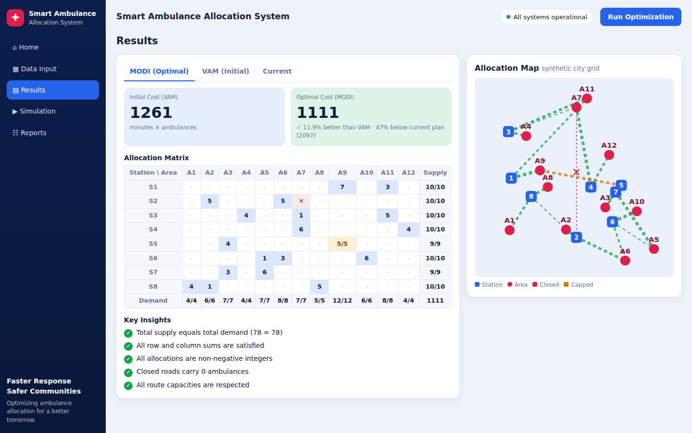
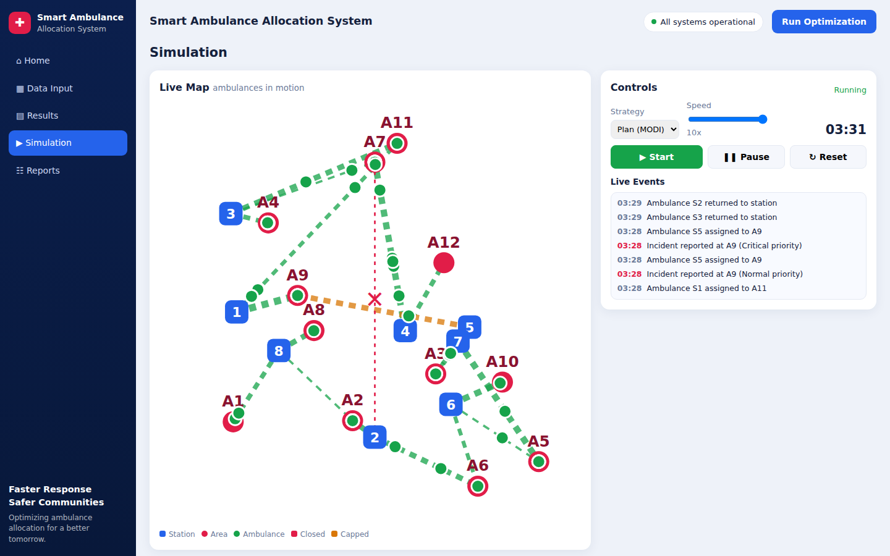
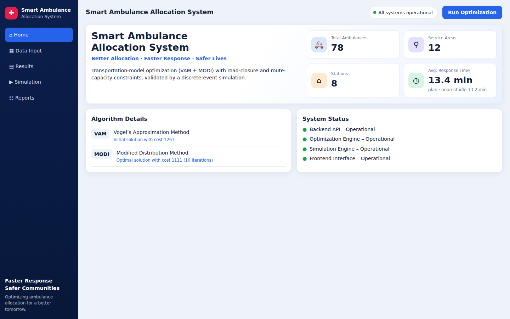
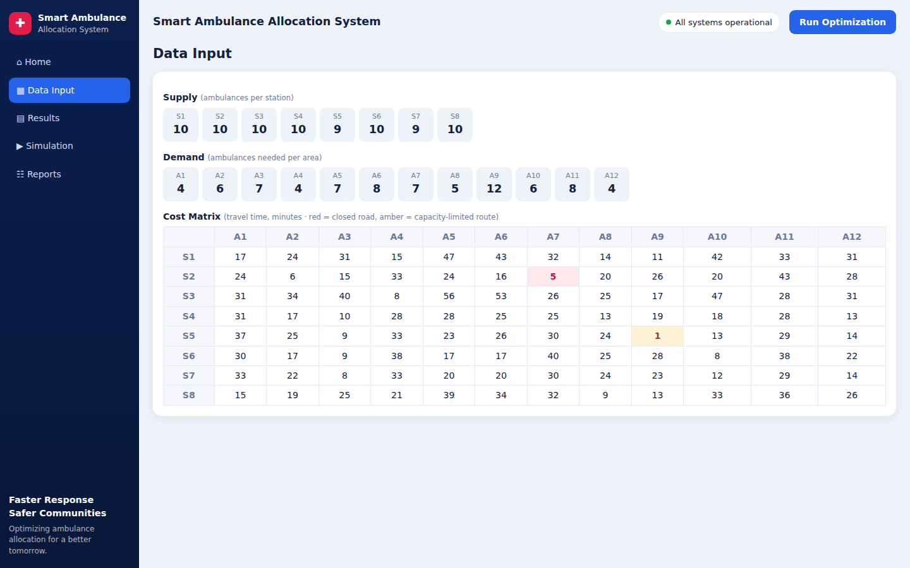
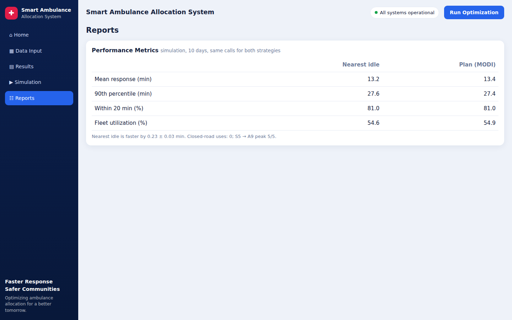

# Smart Ambulance Allocation System

A web application that decides **how many ambulances each station should send to each service area** at the lowest total travel time, then checks the plan with a **discrete-event simulation** of emergency calls.

- **Optimization:** transportation model solved with Vogel's Approximation Method (VAM) for the initial solution and the MODI (u-v) method to reach the optimum.
- **Constraints:** a closed road and a route with a limited number of ambulances, enforced in the optimizer *and* the simulation.
- **Web UI:** five pages (Home, Data Input, Results, Simulation, Reports) served by a small Flask backend.

> All data is **synthetic** (fixed seed). The map is a schematic grid, not real streets.

## Screenshots

| Results | Simulation (live replay) |
|---|---|
|  |  |

| Home | Data Input | Reports |
|---|---|---|
|  |  |  |

---

## Quick start

Requirements: Python 3.10+ and Git.

```bash
git clone https://github.com/ehabmahmoudramadan-crypto/smart-ambulance-allocation.git
cd smart-ambulance-allocation
pip install -r requirements.txt
python run.py
```

Then open **http://127.0.0.1:5000** in your browser (the app runs on your own machine) and keep the terminal open; closing it stops the server.
`python -m backend.app` does the same. Always run commands from the project root.

**Windows:** if `python run.py` prints nothing, the `python` command on your machine is not the real interpreter (for example a Store alias). Run it with the full path or the launcher:

```powershell
py run.py
& "C:\Users\<you>\AppData\Local\Programs\Python\Python313\python.exe" run.py
```

Run the optimizer without the web app:

```bash
python -m optimization.model
```

Run the tests:

```bash
pytest
```

---

## The problem

| | |
|---|---|
| Stations | 8 (S1-S8), 78 ambulances in total (supply) |
| Service areas | 12 (A1-A12), 78 ambulances needed (demand) |
| Cost | travel time in minutes from station *i* to area *j* |
| Goal | minimize the sum of `x[i][j] * cost[i][j]` with supply and demand fully met |

### Constraints

Both are defined once, in `data/data.json`, and used by every part of the system.

1. **Road S2 -> A7 is closed** (maintenance). No ambulance may use it. It is modelled as a Big-M cost, so the final plan has 0 there.
2. **Route S5 -> A9 carries at most 5 ambulances** (traffic capacity). Station S5 is split into two rows: one with supply 5 and normal costs, and one with the remaining supply and a Big-M cost to A9. Plain VAM and MODI then stay exact, with no special cases.

Big-M is computed from the data (larger than any possible total cost), and the cost shown to the user is always calculated from the real cost matrix, never with M in it.

### Result on the bundled data

| | Total cost |
|---|---|
| Current (manual) plan | 2097 |
| VAM (initial solution) | 1261 |
| **MODI (optimal)** | **1111** (10 iterations) |

Saving against the current plan: 986 minutes (47%). The optimum was confirmed with an exact integer linear program (scipy). Without the two constraints the optimum would be 1016, so the constraints really change the plan.

---

## The simulation

`simulation/` replays random emergency calls and measures the **real response time** (call -> ambulance on scene), which the transportation model alone does not capture.

**Assumptions**

- Calls arrive as a Poisson process; the area of each call is drawn in proportion to the area's demand.
- Priorities: 20% critical, 30% urgent, 50% normal. Critical calls are served first.
- Driving time = the cost matrix (minutes). Time on scene is uniform between 20 and 40 minutes. Then the ambulance drives back to its station.
- Capacity constraint in the simulation: at most 5 ambulances of S5 can be on a mission to A9 at the same time.

**Two dispatch strategies** (both obey both constraints):

- **Nearest idle:** send the closest free ambulance.
- **Plan (MODI):** each ambulance is designated to an area by the optimal plan; send a free designated one first, otherwise fall back to the nearest idle one.

Both strategies get exactly the same calls in every run (paired comparison), and results are averaged over repetitions with 95% confidence intervals.

**Result at the default load** (48 calls/hour, 24 h, 10 repetitions, about 1147 calls per run):

| | Nearest idle | Plan (MODI) |
|---|---|---|
| Mean response | 13.2 min | 13.4 min |
| Reached within 20 min | 81.0% | 81.0% |
| Fleet utilization | 54.6% | 54.9% |

The two strategies are practically the same; nearest idle is faster by 0.23 +/- 0.03 min (1.7%). In other words, the optimal plan is **not** faster than a simple dispatch rule here. Its value is a cost-minimal, constraint-respecting distribution, not a speed-up. At very high load (about 80 calls/hour) the fleet is over 90% busy, queues grow, and the UI shows an overload warning.

The audit confirms that in every run **the closed road is used 0 times** and S5 -> A9 never exceeds 5.

---

## The web app

| Page | Address (once the app is running locally) | What it shows |
|---|---|---|
| Home | `/#home` | key numbers, algorithm details, system status |
| Data Input | `/#data` | supply, demand and the cost matrix |
| Results | `/#results` | MODI / VAM / current allocation, costs, key insights, allocation map |
| Simulation | `/#sim` | live replay with moving ambulances, speed control, live events |
| Reports | `/#reports` | strategy comparison with confidence intervals and the constraint audit |

The **Run Optimization** button (top right) re-runs everything from any page. If the page is opened from a file or another dev server, it talks to `http://127.0.0.1:5000` directly.

---

## API

| Method | Endpoint | Description |
|---|---|---|
| GET | `/api/health` | `{"status": "ok"}` |
| GET | `/api/data` | the default problem (names, supply, demand, costs, coordinates, constraints) |
| POST | `/api/solve` | VAM + MODI; the JSON body may override `supply`, `demand`, `cost_matrix`, `closed`, `caps`, `current_allocation` |
| POST | `/api/simulate` | comparison of both strategies: `incidents_per_hour` (1-100), `hours` (1-48), `reps` (1-30), `seed` |
| POST | `/api/simulate/run` | one run as a list of missions for the live replay: `strategy` (`plan` / `greedy`), `incidents_per_hour`, `hours` (1-12), `seed` |

Invalid input returns HTTP 400 with `{"error": "..."}`.

---

## Project structure

```
smart-ambulance-allocation/
├── run.py                 start the web app (prints each step)
├── requirements.txt
├── data/
│   └── data.json          stations, areas, supply, demand, costs, coordinates, constraints
├── optimization/
│   ├── model.py           constraints, Big-M / station split, solve(), validation
│   ├── vam.py             Vogel's Approximation Method
│   └── modi.py            MODI (u-v) optimization on a spanning-tree basis
├── simulation/
│   ├── incident.py        an emergency call
│   ├── ambulance.py       ambulance agent and its states
│   ├── dispatcher.py      nearest-idle and plan strategies, constraint checks
│   └── engine.py          event loop, metrics, paired comparison, replay
├── backend/
│   └── app.py             Flask app and JSON API
├── frontend/
│   ├── index.html         the five pages
│   ├── style.css
│   └── script.js          rendering, map, live replay, navigation
├── tests/                 data, optimizer, simulation and API tests
└── docs/screenshots/      images used in this README
```

### Data format (`data/data.json`)

`stations`, `areas` (names) - `supply`, `demand` (lists of integers, equal sums) - `cost_matrix` (stations x areas, minutes) - `station_coords_km`, `area_coords_km` (used only to draw the map) - `current_allocation` (a baseline plan to compare with) - `constraints`: `closed_roads` (`from`, `to`) and `route_capacities` (`from`, `to`, `max`).

---

## Tests

`pytest` runs four groups:

- **data:** shapes, supply = demand, positive integers, constraints point to real cells, the baseline plan is valid.
- **optimization:** the bundled data gives exactly 1111, the constraints matter (1016 vs 1111), and 300 random problems with random constraints match an exact integer LP (infeasible random cases are skipped).
- **simulation:** constraints are never violated at low, normal and high load, same seed gives the same result, both strategies see the same calls, response is never faster than driving time, all ambulances end at their stations.
- **API:** every endpoint, bad inputs return 400.

---

## Limitations

- Only **one capacity constraint per station** is supported by the station-split method.
- The data is synthetic, and the map coordinates are not real locations.
- The simulation does not model traffic variation, hospital drop-off or re-dispatching an ambulance that is already driving.
- Data cannot yet be edited from the UI (change `data/data.json` instead).
- The Flask server runs in development mode (`debug=False`); it is meant for local demos, not deployment.

---

## نبذة بالعربي

نظام لتخصيص عربيات الإسعاف على المناطق بأقل زمن وصول إجمالي، باستخدام نموذج النقل (VAM ثم MODI) مع قيدين: طريق مقفول (S2 → A7) وحد أقصى 5 عربيات على مسار S5 → A9. بعد التخصيص، المحاكاة بتجرب النظام على بلاغات عشوائية وبتقارن بين اتباع الخطة وإرسال أقرب عربية متاحة. التشغيل: `pip install -r requirements.txt` ثم `python run.py` وافتح `http://127.0.0.1:5000`.
